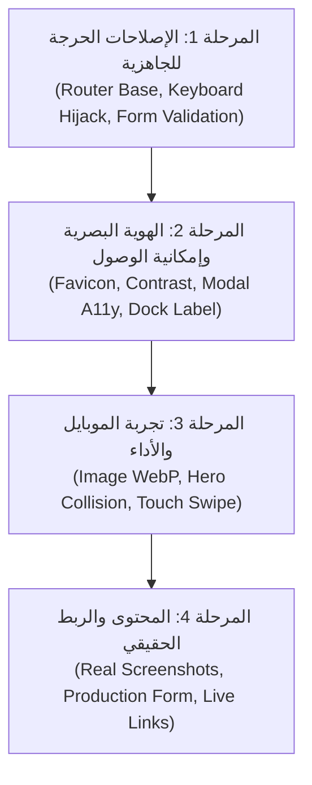

# 📋 تقرير جودة البرمجيات وخطة الإصلاح الشاملة (QA Audit & Remediation Plan)

**المشروع:** Moath Ayman Portfolio  
**المطوّر:** معاذ أيمن (Moath Ayman)  
**تاريخ الفحص:** 3 نوفمبر 2026  
**الدور:** Senior / Lead QA Engineer  
**حالة الجاهزية:** 🟡 في طور التطوير (قريب من الإطلاق مع وجود مشاكل حرجة يجب حلها)  
**المرجع الفني:** `BUILD-BRIEF.md` · `hero-mockup.html` · `CLAUDE.md` · `Identity/`  

---

## 📑 الفهرس
1. [نظرة عامة والتقييم الإجمالي](#1-نظرة-عامة-والتقييم-الإجمالي)
2. [سجل ما تم إنجازه بنجاح (Verified Baseline)](#2-سجل-ما-تم-إنجازه-بنجاح-verified-baseline)
3. [تقرير الفحص والعيوب المرصودة (Detailed Findings)](#3-تقرير-الفحص-والعيوب-المرصودة-detailed-findings)
   - [أولاً: المشاكل الوظيفية والمعمارية (Functional & Architecture)](#أولاً-المشاكل-الوظيفية-والمعمارية)
   - [ثانياً: المشاكل البصرية والواجهات (Visual & UI/UX)](#ثانياً-المشاكل-البصرية-والواجهات)
   - [ثالثاً: إمكانية الوصول والتنقل (Accessibility - A11y)](#ثالثاً-إمكانية-الوصول-والتنقل)
   - [رابعاً: التوافق العربي وتفاصيل الحركة (RTL & Motion)](#رابعاً-التوافق-العربي-وتفاصيل-الحركة)
   - [خامساً: تجربة الهواتف والأجهزة اللمسية (Mobile & Touch UX)](#خامساً-تجربة-الهواتف-والأجهزة-اللمسية)
   - [سادساً: الأداء والسيو والأصول (Performance & SEO)](#سادساً-الأداء-والسيو-والأصول)
   - [سابعاً: مطابقة القواعد الصارمة للمشروع (Rules Compliance)](#سابعاً-مطابقة-القواعد-الصارمة-للمشروع)
4. [خطة الإصلاح المرحلية (Remediation Roadmap)](#4-خطة-الإصلاح-المرحلية-remediation-roadmap)
5. [قائمة المهام التفاعلية للمتابعة (Interactive To-Do List)](#5-قائمة-المهام-التفاعلية-للمتابعة-interactive-to-do-list)

---

## 1. نظرة عامة والتقييم الإجمالي

المشروع يمتلك **فكرة هندسية استثنائية وطابعاً بصرياً فريداً**؛ القرص الدوار (Rotating Wheel Geometry) يعكس تخصصك كمطوّر أنظمة يفكّر خارج الصندوق. نظام الرموز اللوني (Design Tokens) وتطبيق الخصائص المنطقية للغة العربية (Logical Properties) نُفذ بمستوى عالٍ من الدقة.

مع ذلك، هناك **ثغرات تقنية وعملية حرجة** (مثل اختطاف أزرار الكيبورد في الفورم، وخطأ توجيه المسار مع GitHub Pages، وغياب التحقق في نموذج التواصل، وثقل حجم الصور) تحتاج للإصلاح قبل النشر النهائي.

### لوحة تقييم الجودة (QA Scorecard)

| المحور | التقييم | الحالة | الأثر العملي |
| :--- | :---: | :---: | :--- |
| **المعمارية والبناء (Architecture & Routing)** | 8.0 / 10 | 🟡 | خطأ مسار Base URL مع GitHub Pages يسبب 404 عند الـ Refresh. |
| **الوظائف والتفاعل (Functionality & Forms)** | 6.5 / 10 | 🔴 | أسهم الكيبورد تدير القرص أثناء كتابة الرسالة، والفورم شكلي. |
| **الهوية البصرية والواجهات (Visual & UI)** | 8.5 / 10 | 🟡 | أيقونة الفافيكون الافتراضية لا تتبع الهوية، وتداخل صورة الهيرو في الموبايل. |
| **التوافق العربي وتعدد اللغات (i18n & RTL)** | 9.0 / 10 | 🟢 | ممتاز جداً مع تفاصيل بسيطة في توقيت الآلة الكاتبة. |
| **إمكانية الوصول (Accessibility - A11y)** | 6.0 / 10 | 🔴 | تسمية خاطئة للـ Dock، ونقص في Focus Trap لنافذة المشاريع. |
| **الأداء والأصول (Performance & Assets)** | 6.5 / 10 | 🔴 | صورة الهيرو بحجم 1.9MB PNG تبطئ التحميل على الجوال. |

---

## 2. سجل ما تم إنجازه بنجاح (Verified Baseline)

هذه العناصر تم فحصها والتأكد من مطابقتها العالية للمواصفات والمتطلبات في `BUILD-BRIEF.md`:

- [x] **بناء القرص الدوار (Wheel Architecture):** تنفيذ دوران القرص بزوايا `--step: 30deg` وتطبيق الدوران العكسي على كبائن المحتوى ليظل مستوياً، مع حساب نصف القطر `R` ديناميكياً عند الـ resize.
- [x] **منع التمرير الافتراضي للصفحة:** تطبيق `body { overflow: hidden }` واستخدام وحدات `100dvh` بدلاً من `100vh`.
- [x] **تطبيق الخصائص المنطقية (CSS Logical Properties):** كتابة التنسيقات باستخدام `inset-inline-start/end`, `padding-inline`, `margin-inline` في كامل الملفات تقريباً.
- [x] **إدارة الحالة بدون Pinia:** الاعتماد الذكي على الـ Router والـ Composable المشترك [`useSections.js`](file:///c:/Users/Moath/Desktop/Projects/moath-portfolio/src/composables/useSections.js).
- [x] **عزل الأقسام غير المعروضة:** تطبيق `:inert="i !== cur"` و `:aria-hidden="i !== cur ? 'true' : undefined"` لمنع تفاعل الكيبورد وقارئات الشاشة مع الأقسام غير النشطة.
- [x] **دعم وضع تقليل الحركة (`prefers-reduced-motion`):** إيقاف دوران القرص والانتقال بنعومة عبر Crossfade مدته 200ms، مع إيقاف وميض مؤشر الكتابة.
- [x] **حماية التباين اللوني (Color Contrast Rule):** الالتزام بعدم وضع نص أبيض فوق لون `--color-primary`، وقصره على الأيقونات والحدود بينما تُستخدم أزرار `--color-primary-deep` للنصوص البيضاء.
- [x] **التمرير الداخلي في شاشات الموبايل:** توفير Scroll داخلي مستقل لأقسام المحتوى الطويل (About, Skills, Experience, Contact) لمنع انقطاع المحتوى.
- [x] **التنقل بالروابط العميقة (Deep Linking):** تسجيل كل قسم كـ Route مستقل (`/about`, `/skills`, `/projects`, ...).

---

## 3. تقرير الفحص والعيوب المرصودة (Detailed Findings)

### أولاً: المشاكل الوظيفية والمعمارية

#### 🔴 عيب 1.1: عدم تمرير `BASE_URL` في `createWebHistory` مما يكسر الروابط في GitHub Pages
* **المكان:** [`src/router/index.js`](file:///c:/Users/Moath/Desktop/Projects/moath-portfolio/src/router/index.js#L18-L21) مقابل [`vite.config.js`](file:///c:/Users/Moath/Desktop/Projects/moath-portfolio/vite.config.js#L6)
* **التفاصيل:**
  في `vite.config.js` تم ضبط المسار الأساسي `base: '/Portfolio/'` ليلائم النشر على GitHub Pages (`https://imoathayman.github.io/Portfolio/`).  
  لكن داخل ملف التوجيه:
  ```javascript
  // الوضع الحالي:
  const router = createRouter({
    history: createWebHistory(), // ⚠️ لا يستلم base URL
    routes,
  })
  ```
* **الأثر:** عند تصفح الموقع المرفوع على GitHub Pages، سيقوم Vue Router بالتوجيه إلى `/about` بدلاً من `/Portfolio/about`. عند الضغط على تحديث الصفحة (F5) سيعيد سيرفر GitHub خطأ **404 Not Found**.
* **الإصلاح المطلوب:**
  ```javascript
  history: createWebHistory(import.meta.env.BASE_URL)
  ```
  وإضافة ملف `public/404.html` لإعادة توجيه مسارات SPA على GitHub Pages.

---

#### 🔴 عيب 1.2: اختطاف مفاتيح الأسهم أثناء الكتابة في نموذج التواصل
* **المكان:** [`src/App.vue`](file:///c:/Users/Moath/Desktop/Projects/moath-portfolio/src/App.vue#L21-L24)
* **التفاصيل:**
  مستمع الكيبورد يستجيب لـ `ArrowDown` و `ArrowUp` على مستوى الـ `window` بالكامل دون استثناء حقول الإدخال:
  ```javascript
  function onKeydown(e) {
    if (e.key === 'ArrowDown') go(cur.value + 1)
    if (e.key === 'ArrowUp') go(cur.value - 1)
  }
  ```
* **الأثر:** عندما يكتب الزائر رسالة في حقل `<textarea>` أو `<input>` في قسم التواصل، ويضغط السهم للأعلى لتعديل كلمة، يدور الموقع بأكمله ويخرج الزائر من قسم التواصل إلى الخبرة!
* **الإصلاح المطلوب:**
  ```javascript
  function onKeydown(e) {
    if (['INPUT', 'TEXTAREA', 'SELECT'].includes(e.target.tagName)) return
    if (e.key === 'ArrowDown') go(cur.value + 1)
    if (e.key === 'ArrowUp') go(cur.value - 1)
  }
  ```

---

#### 🔴 عيب 1.3: نموذج التواصل غير فعّال ولا يحتوي على أي تحقق (Validation & Reset)
* **المكان:** [`src/views/ContactView.vue`](file:///c:/Users/Moath/Desktop/Projects/moath-portfolio/src/views/ContactView.vue#L47-L75)
* **التفاصيل:**
  1. لا يوجد أي وسوم تحقق (`required`, `minlength`, نوع بريد إلكتروني صحيح). يمكن للمستخدم الضغط على "إرسال" وهو فارغ وتظهر رسالة النجاح مباشرة.
  2. النموذج غير مربوط بأي خادم أو خدمة مراسلة (مثل Formspree أو EmailJS أو Netlify Forms).
  3. بمجرد ظهور رسالة النجاح، يختفي النموذج نهائياً ولا يوجد أي خيار أو زر لـ "إرسال رسالة أخرى" إلا بعمل تحديث يدوي للموقع.
* **الإصلاح المطلوب:**
  - إضافة سمات التحقق `required` ورسائل تنبيه للمستخدم.
  - ربط النموذج بنقطة نهاية حقيقية (مثلاً Formspree endpoint مجاني).
  - إضافة زر "إرسال رسالة أخرى" يعيد ضبط `submitted.value = false` وتفريغ الحقول.

---

#### 🔴 عيب 1.4: سلوك زر الرجوع للمتصفح عند فتح تفاصيل المشروع (Modal FLIP)
* **المكان:** [`src/views/ProjectsView.vue`](file:///c:/Users/Moath/Desktop/Projects/moath-portfolio/src/views/ProjectsView.vue#L33-L84)
* **التفاصيل:**
  فتح تفاصيل المشروع لا يغيّر الـ URL (مثل `?project=dent` أو `#dent`).
* **الأثر:** على الهواتف، الطبيعة التلقائية للمستخدم هي استخدام إيماءة الرجوع للخلف لإغلاق النافذة المنبثقة. حالياً الرجوع يعيد المستخدم إلى القسم السابق في الموقع أو يغادر الموقع كلياً بدلاً من إغلاق النافذة.
* **الإصلاح المطلوب:** ربط فتح المشروع بـ query parameter في الراوتر، أو استدعاء `window.history.pushState` لتمكين زر الرجوع من إغلاق النافذة بسلاسة.

---

#### 🟡 عيب 1.5: غياب مسار Catch-All / 404 في Vue Router
* **المكان:** [`src/router/index.js`](file:///c:/Users/Moath/Desktop/Projects/moath-portfolio/src/router/index.js#L9-L16)
* **التفاصيل:** جدول التوجيه يحتوي فقط على الأقسام الستة. إذا دخل المستخدم رابطاً خاطئاً مثل `/Portfolio/portfolio` أو `/test`، فإن `route.name` يصبح `undefined` ويعود الـ `cur` إلى `0` (Hero) دون توجيه صريح أو إشعار.
* **الإصلاح المطلوب:** إضافة `{ path: '/:pathMatch(.*)*', redirect: '/' }`.

---

#### 🟡 عيب 1.6: عدم تفاعلية `prefers-reduced-motion` مع تغييرات نظام التشغيل المباشرة
* **المكان:** [`src/composables/useSections.js:11`](file:///c:/Users/Moath/Desktop/Projects/moath-portfolio/src/composables/useSections.js#L11) و [`src/views/HeroView.vue:10`](file:///c:/Users/Moath/Desktop/Projects/moath-portfolio/src/views/HeroView.vue#L10)
* **التفاصيل:** قراءة الخاصية تتم لمرة واحدة فقط عند تحميل الملف: `matchMedia('(prefers-reduced-motion: reduce)').matches`. إذا قام المستخدم أو برمجيات فحص الوصول بتغيير تفضيل الحركة أثناء الجلسة، فلن يتحدث المتغير التفاعلي في الجافاسكربت لعدم وجود `addEventListener('change')`.

---

### ثانياً: المشاكل البصرية والواجهات

#### 🟡 عيب 2.1: أيقونة الفافيكون الافتراضية لـ Vite (Purple Lightning)
* **المكان:** [`public/favicon.svg`](file:///c:/Users/Moath/Desktop/Projects/moath-portfolio/public/favicon.svg)
* **التفاصيل:** الملف الحالي يحتوي على تصميم Vite الافتراضي المكون من ألوان بنفسجية فاقعة (`#863bff`, `#7e14ff`). يتناقض كلياً مع هويتك المعتمدة (الأزرق الهادئ `#5FA8D3` والداكن `#2C6E9E`).
* **الإصلاح المطلوب:** استبدال محتوى الملف برسمة المونوغرام (M+A) بلون موحد داكن/أزرق كما هو موضح في `BUILD-BRIEF.md § 7`.

---

#### 🟡 عيب 2.2: تداخل صورة الهيرو مع الأزرار والنصوص على الشاشات المتوسطة
* **المكان:** [`src/views/HeroView.vue`](file:///c:/Users/Moath/Desktop/Projects/moath-portfolio/src/views/HeroView.vue#L230-L250)
* **التفاصيل:** في الشاشات بعرض أقل من 900px وارتفاع بين 600px و 750px:
  - المحتوى يبدأ عند `top: 32%` ويصل إلى ~450px من أعلى الشاشة.
  - الصورة بارتفاع `50vh` ومثبتة في القاع `bottom: 0`.
* **الأثر:** النص وأزرار الـ CTA تركب مباشرة فوق وجه وصدر الصورة الشخصية مما يسبب تشوهاً في القراءة.
* **الإصلاح المطلوب:** إزاحة الصورة إلى أقصى الطرف في الموبايل أو تقليص ارتفاعها إلى `38vh` على الشاشات ذات الارتفاع القصير.

---

#### 🟡 عيب 2.3: استخدام Wireframe وهمي موحد لجميع المشاريع
* **المكان:** [`src/components/ProjectWindowPlaceholder.vue`](file:///c:/Users/Moath/Desktop/Projects/moath-portfolio/src/components/ProjectWindowPlaceholder.vue)
* **التفاصيل:** المشاريع الثلاثة (DENT, Burgelo, SpaceFlex) تستعرض نفس الشكل الرمادي التجريدي ذي الثلاثة أسطر.
* **الأثر:** يقلل من القيمة الاحترافية للمشاريع ويبدو الموقع كقالب غير مكتمل.
* **الإصلاح المطلوب:** إدراج لقطات شاشة حقيقية لكل مشروع (مع استخدام الـ Placeholder كـ Fallback فقط).

---

#### 🟡 عيب 2.4: ضعف تباين زر تبديل اللغة غير النشط (WCAG Contrast Failure)
* **المكان:** [`src/components/AppChrome.vue`](file:///c:/Users/Moath/Desktop/Projects/moath-portfolio/src/components/AppChrome.vue#L108)
* **التفاصيل:** زر اللغة غير النشط يأخذ `opacity: 0.5` مع اللون `#2B2B28` فوق خلفية `#FDFCF9`. نسبة التباين الناتجة هي **2.85:1**، بينما يشترط معيار WCAG AA نسبة تباين لا تقل عن **4.5:1** للنصوص العادية.
* **الإصلاح المطلوب:** رفع شفافية الزر غير النشط إلى `opacity: 0.72` أو استخدام `--color-ink-2`.

---

#### 🟡 عيب 2.5: نصوص مسودات وروابط وهمية منشورة بالواجهة
* **المكان:** [`src/i18n/locales/ar.json`](file:///c:/Users/Moath/Desktop/Projects/moath-portfolio/src/i18n/locales/ar.json) و [`en.json`](file:///c:/Users/Moath/Desktop/Projects/moath-portfolio/src/i18n/locales/en.json)
* **التفاصيل:**
  1. في قسم الخبرة يظهر نص `"حدّد التاريخ"` / `"ADD DATE"` مع خط متقطع.
  2. زرا "عرض حي" في مشروعي DENT و Burgelo يوجهان إلى `#`.
* **الإصلاح المطلوب:**
  - وضع التاريخ الفعلي لمشروع دعوة الزفاف (مثلاً "٢٠٢٤").
  - تعطيل زر العرض الحي أو تحويله إلى وسم "قيد التطوير" إذا لم يتوفر رابط حالي.

---

#### 🟡 عيب 2.6: اتجاه سهم التواصل في الـ Dock مع اللغة العربية
* **المكان:** [`src/components/AppChrome.vue`](file:///c:/Users/Moath/Desktop/Projects/moath-portfolio/src/components/AppChrome.vue)
* **التفاصيل:** أيقونة التواصل في الـ Dock عبارة عن سهم يتجه نحو الأعلى واليمين (Diagonal Arrow). في حين أن روابط المشاريع والتواصل في الصفحات الداخلية يتم عمل `scaleX(-1)` لها في وضع العربي لتشير إلى الأعلى واليسار، فإن أيقونة الـ Dock تظل تشير إلى اليمين دوماً.

---

### ثالثاً: إمكانية الوصول والتنقل

#### 🔴 عيب 3.1: تسمية شريط الـ Dock بالكامل باسم "البداية" (Wrong Landmark Label)
* **المكان:** [`src/components/AppChrome.vue:28`](file:///c:/Users/Moath/Desktop/Projects/moath-portfolio/src/components/AppChrome.vue#L28)
```html
<nav class="dock" :aria-label="t('nav.hero')">
```
* **الأثر:** قارئات الشاشة تعلن للمستخدم الكفيف: *"قائمة تنقل البداية"* (Start navigation) بالرغم من أنها شريط التنقل الرئيسي لكامل الموقع.
* **الإصلاح المطلوب:** تغيير التسمية إلى `t('nav.main')` (مثلاً: "أقسام الموقع" / "Site Sections").

---

#### 🔴 عيب 3.2: غياب معايير الـ Dialog و Focus Trap داخل نافذة تفاصيل المشاريع
* **المكان:** [`src/views/ProjectsView.vue:134`](file:///c:/Users/Moath/Desktop/Projects/moath-portfolio/src/views/ProjectsView.vue#L134)
* **التفاصيل:**
  1. الحاوية `.pr-detail` لا تملك سمات `role="dialog"` و `aria-modal="true"`.
  2. عند فتح النافذة، لا ينتقل التركيز (Focus) إلى زر الإغلاق أو محتوى النافذة.
  3. يمكن لمستخدم الكيبورد الضغط على زر Tab ليخرج من تفاصيل المشروع ويتنقل داخل الـ Dock في الخلفية.
  4. عند إغلاق النافذة، لا يعود التركيز إلى الكرت الذي تم فتحه.

---

#### 🟡 عيب 3.3: غياب رابط التخطي (Skip Link)
* **المكان:** [`src/App.vue`](file:///c:/Users/Moath/Desktop/Projects/moath-portfolio/src/App.vue)
* **التفاصيل:** غياب عنصر `<a href="#content" class="sr-only">تخطي إلى المحتوى</a>` يجبر مستخدمي الكيبورد وقارئات الشاشة على المرور على اللوجو ومبدل اللغة قبل الوصول للمحتوى في كل انتقال.

---

### رابعاً: التوافق العربي وتفاصيل الحركة

#### 🟡 عيب 4.1: سرعة الآلة الكاتبة في العربية مفاجئة وغير مريحة
* **المكان:** [`src/views/HeroView.vue:45`](file:///c:/Users/Moath/Desktop/Projects/moath-portfolio/src/views/HeroView.vue#L45)
* **التفاصيل:**
  في العربية، الكتابة كلمة بكلمة بتأخير `150ms`. جملة *"مطوّر أنظمة full-stack"* تتكون من 3 كلمات فقط، فتكتمل كتابتها في **450ms (أقل من نصف ثانية)**، بينما في الإنجليزية تكتب حرفاً بحرف وتستغرق **1540ms**.
* **الأثر:** ظهور النص العربي سريع جداً كأنه وميض خاطف ثم يتوقف ثانيتين.
* **الإصلاح المطلوب:** زيادة التأخير بين الكلمات في العربية إلى `350ms - 400ms`.

---

#### 🟡 عيب 4.2: قفز المؤشر المومض (Caret) مع الكلمات اللاتينية داخل النص العربي
* **المكان:** `roles: ["مطوّر أنظمة full-stack"]`
* **التفاصيل:** وجود كلمة لاتينية `full-stack` في نهاية عبارة عربية داخل اتجاه `rtl` قد يجعل المؤشر `.hero-caret` يقفز إلى أقصى اليمين في بعض المتصفحات.
* **الإصلاح المطلوب:** إحاطة النص بـ `<bdi>{{ roleText }}</bdi>`.

---

### خامساً: تجربة الهواتف والأجهزة اللمسية

#### 🟡 عيب 5.1: غياب إيماءات اللمس والسحب (Swipe Gestures)
* **المكان:** [`src/App.vue`](file:///c:/Users/Moath/Desktop/Projects/moath-portfolio/src/App.vue)
* **التفاصيل:** الموقع يعتمد كلياً على النقر على أيقونات الـ Dock في أسفل الشاشة للتنقل. على الهواتف الذكية، يتوقع المستخدم غريزياً أن يؤدي السحب بإصبعه للأعلى أو الأسفل إلى الانتقال للشريحة التالية.
* **الإصلاح المطلوب:** إضافة معالج لأحداث `touchstart` و `touchend` على حاوية `.stage`.

---

#### 🟡 عيب 5.2: احتمال قص بيانات المشروع على الهواتف الصغيرة
* **المكان:** [`src/views/ProjectsView.vue:500`](file:///c:/Users/Moath/Desktop/Projects/moath-portfolio/src/views/ProjectsView.vue#L500)
* **التفاصيل:** في وضع الموبايل، نافذة تفاصيل المشروع تأخذ 44% للنافذة في الأعلى، بينما تتكدس باقي البيانات (العنوان، الدور، الوصف، الإحصائيات، الشيبس، الرابط) في الأسفل بدون `overflow-y: auto`. في حال كانت الشاشة قصيرة، تنقطع الأرقام والروابط في الأسفل.
* **الإصلاح المطلوب:** إضافة `overflow-y: auto` على `.pr-info` في الميديا كويري الخاص بالموبايل.

---

### سادساً: الأداء والسيو والأصول

#### 🔴 عيب 6.1: صورة الهيرو الشخصية غير مضغوطة بحجم 1.9MB
* **المكان:** [`src/assets/moath.png`](file:///c:/Users/Moath/Desktop/Projects/moath-portfolio/src/assets/moath.png)
* **التفاصيل:** صورة الـ PNG بحجم **1,902,800 بايت (1.9MB)** يتم تحميلها في أول زيارة.
* **الأثر:** تأخر كبير في معيار LCP (Largest Contentful Paint) على اتصالات 3G/4G.
* **الإصلاح المطلوب:** تحويل الصورة إلى **WebP** وضغطها ليصل حجمها إلى **~150KB** (توفير أكثر من 90% من الحجم).

---

#### 🟡 عيب 6.2: صورة الشعار بحجم 389KB لـ 34 بكسل
* **المكان:** [`src/assets/logo.png`](file:///c:/Users/Moath/Desktop/Projects/moath-portfolio/src/assets/logo.png)
* **التفاصيل:** صورة شعار بارتفاع 34px فقط حجمها 389KB.
* **الإصلاح المطلوب:** تحويل الشعار إلى كود SVG أصلي أو صورة WebP خفيفة لا تتعدى 10KB.

---

#### 🟡 عيب 6.3: نقص وسوم Open Graph و Twitter Cards في الرأس
* **المكان:** [`index.html`](file:///c:/Users/Moath/Desktop/Projects/moath-portfolio/index.html)
* **التفاصيل:** الصفحة تحتوي على `<title>` و `<meta name="description">` فقط، وتخلو من وسوم `og:image`, `og:title`, `og:description`, `twitter:card`.
* **الأثر:** عند مشاركة رابط البورتفوليو على LinkedIn أو WhatsApp أو Twitter، لا تظهر بطاقة معاينة جذابة.

---

### سابعاً: مطابقة القواعد الصارمة للمشروع

في ملف [`CLAUDE.md § Project Rule`](file:///c:/Users/Moath/Desktop/Projects/moath-portfolio/CLAUDE.md#L19-L31):
> *"Any `left` or `right` property (or value) in CSS is a bug."*

تم رصد مخالفتين مباشرتين:
1. **في [`src/components/AppWheel.vue:58`](file:///c:/Users/Moath/Desktop/Projects/moath-portfolio/src/components/AppWheel.vue#L58):**
   ```css
   .wheel {
     position: absolute;
     left: 50%; /* ⚠️ مخالفة مباشرة */
     top: calc(50% + var(--R));
   ```
   *التصحيح:* استبدالها بـ `inset-inline-start: 50%;`
2. **في [`src/views/ProjectsView.vue:30`](file:///c:/Users/Moath/Desktop/Projects/moath-portfolio/src/views/ProjectsView.vue#L30):**
   استخدام `rect.left - h.left` في دالة الـ FLIP JS.

---

## 4. خطة الإصلاح المرحلية (Remediation Roadmap)



### المرحلة 1: الإصلاحات الحرجة الفورية (Must Fix Before Deployment)
1. ضبط الـ Base URL في `src/router/index.js` ليعمل بسلاسة مع GitHub Pages بدون 404.
2. حماية حقول الإدخال في `App.vue` من اختطاف الأسهم.
3. معالجة نموذج التواصل وإضافة التحقق الأولي وزر إعادة الإرسال.
4. إزالة خاصية `left: 50%` في `AppWheel.vue` واستبدالها بـ `inset-inline-start: 50%`.

### المرحلة 2: الهوية البصرية وإمكانية الوصول (Visual & Accessibility Polish)
1. إنشاء واستبدال أيقونة `favicon.svg` بشعار مونوغرام موحد.
2. تصحيح تسمية الـ Dock في `AppChrome.vue`.
3. تطبيق معايير الـ Dialog وحصر التركيز داخل نافذة المشاريع المنبثقة.
4. تعديل تباين زر اللغة غير النشط ليطابق WCAG AA.
5. تعديل سرعة الآلة الكاتبة في العربية وعزل BiDi.

### المرحلة 3: تجربة الموبايل والأداء (Mobile & Performance)
1. تحويل `moath.png` و `logo.png` إلى صيغة WebP لتسريع التحميل بنسبة 90%.
2. معالجة تداخل صورة الهيرو مع الأزرار في الهواتف القصيرة.
3. إضافة خاصية السحب باللمس (Touch Swipe) للتنقل باليد الواحدة.
4. إضافة `overflow-y: auto` لتفاصيل المشاريع في الموبايل لمنع قص المحتوى.

### المرحلة 4: المحتوى والربط النهائي (Content & Production Wiring)
1. استبدال Wireframes المشاريع بلقطات شاشة أو Mockups حقيقية.
2. تصحيح تواريخ دعوة الزفاف وإزالة نصوص المسودات (`"حدّد التاريخ"`).
3. ربط نموذج التواصل بـ Formspree أو backend حقيقي لاستقبال الرسائل.
4. إضافة وسوم Open Graph و Twitter Cards في `index.html`.

---

## 5. قائمة المهام التفاعلية للمتابعة (Interactive To-Do List)

> **إرشادات:** هذه القائمة تمثل مرجعك الحي، قم بوضع علامة `[x]` أمام أي بند فور اكتماله.

### ✅ الأساسات المنجزة والمحققة سابقاً
- [x] بناء قرص التوجيه الدوار وهندسة الدوران المعاكس للكابينات
- [x] إعداد نظام Design Tokens في `style.css` للألوان والحركات
- [x] اعتماد الخصائص المنطقية Logical Properties في كامل الموقع تقريباً
- [x] تطبيق وحدات `100dvh` وعزل الأقسام غير النشطة بـ `inert`
- [x] دعم وضع تقليل الحركة `prefers-reduced-motion` بنقلة ناعمة
- [x] توازن خط Cairo بين اللغتين في نصوص الهيرو
- [x] ضبط سكرول الموبايل الداخلي للأقسام الأربعة الطويلة

---

### 🚨 المرحلة 1: الإصلاحات الحرجة الفورية — [مكتملة بالكامل ✅]
- [x] **Router Base:** إضافة `import.meta.env.BASE_URL` داخل `createWebHistory` في [`src/router/index.js`](file:///c:/Users/Moath/Desktop/Projects/moath-portfolio/src/router/index.js).
- [x] **GitHub Pages 404:** إنشاء ملف `public/404.html` لدعم Deep Linking عند التحديث.
- [x] **Catch-all Route:** إضافة توجيه `/:pathMatch(.*)*` في الراوتر لإعادة توجيه أي مسار خاطئ.
- [x] **منع اختطاف الكيبورد:** فحص `e.target` في مستمع الأسهم بـ [`src/App.vue`](file:///c:/Users/Moath/Desktop/Projects/moath-portfolio/src/App.vue) لتجاهل `input` و `textarea`.
- [x] **تحقق الفورم:** إضافة سمات `required` ونوع `type="email"` وتنبيهات الحقول في [`src/views/ContactView.vue`](file:///c:/Users/Moath/Desktop/Projects/moath-portfolio/src/views/ContactView.vue).
- [x] **إعادة إرسال الفورم:** إضافة زر "إرسال رسالة أخرى" لإعادة إظهار النموذج بعد الإرسال الناجح.
- [x] **الالتزام بالقواعد:** استبدال `left: 50%` في [`src/components/AppWheel.vue:58`](file:///c:/Users/Moath/Desktop/Projects/moath-portfolio/src/components/AppWheel.vue#L58) بـ `inset-inline-start: 50%`.

---

### 🎨 المرحلة 2: الهوية البصرية وإمكانية الوصول — [مكتملة بالكامل ✅]
- [x] **Favicon:** استبدال صاعقة Vite البنفسجية في [`public/favicon.svg`](file:///c:/Users/Moath/Desktop/Projects/moath-portfolio/public/favicon.svg) بأيقونة المونوغرام باللون الأزرق المعتمد.
- [x] **تسمية الـ Dock:** تعديل `aria-label` في [`src/components/AppChrome.vue:28`](file:///c:/Users/Moath/Desktop/Projects/moath-portfolio/src/components/AppChrome.vue#L28) إلى `t('nav.title')` ("أقسام الموقع" / "Site sections").
- [x] **تباين مبدل اللغة:** زيادة تباين الزر غير النشط في [`src/components/AppChrome.vue`](file:///c:/Users/Moath/Desktop/Projects/moath-portfolio/src/components/AppChrome.vue) ليحقق معيار 4.5:1.
- [x] **إمكانية وصول نافذة المشاريع:** إضافة `role="dialog"` و `aria-modal="true"` ونقل التركيز لزر الإغلاق عند الفتح في [`src/views/ProjectsView.vue`](file:///c:/Users/Moath/Desktop/Projects/moath-portfolio/src/views/ProjectsView.vue).
- [x] **توقيت الآلة الكاتبة بالعربي:** زيادة التأخير بين الكلمات في العربية إلى `360ms` في [`src/views/HeroView.vue`](file:///c:/Users/Moath/Desktop/Projects/moath-portfolio/src/views/HeroView.vue).
- [x] **عزل BiDi:** إحاطة نص المسميات بـ `<bdi>` لمنع قفز المؤشر المومض بعد كلمة `full-stack`.
- [x] **رابط التخطي (Skip Link):** إضافة رابط وصول سريع للمحتوى في أعلى الصفحة لقارئات الشاشة.

---

### 📱 المرحلة 3: تجربة الموبايل والأداء — [مكتملة بالكامل ✅]
- [x] **ضغط صورة الهيرو:** تحويل `src/assets/moath.png` (1.9MB) إلى صيغة WebP بحجم 102KB (توفير 94.6%).
- [x] **تحسين الشعار:** تحويل `src/assets/logo.png` (389KB) إلى WebP بحجم 24KB (توفير 93.7%).
- [x] **تداخل صورة الهيرو:** تعديل أبعاد وموقع الصورة في الموبايل لمنع تغطيتها لأزرار الدعوة والنصوص.
- [x] **إيماءات اللمس (Swipe):** إضافة مستمعي `touchstart` و `touchend` على حاوية الشاشة للتنقل بالسحب الرأسي.
- [x] **تمرير تفاصيل المشاريع:** إضافة `overflow-y: auto` لكتلة معلومات المشروع في الموبايل لمنع قص المحتوى على الشاشات القصيرة.
- [x] **تفاعلية تقليل الحركة:** إضافة مستمع `change` على `matchMedia` لتحديث تفضيل الحركة مباشرة.

---

### 🚀 المرحلة 4: المحتوى الحقيقي والنشر النهائي
- [ ] **لقطات المشاريع:** استبدال نوافذ الـ Wireframe الموحدة بصور ومعاينات حقيقية للمشاريع (DENT, Burgelo, SpaceFlex).
- [x] **تصحيح نصوص المسودات:** استبدال `"حدّد التاريخ"` / `"ADD DATE"` بتاريخ حقيقي (`"سبتمبر ٢٠٢٤"` / `"Sep 2024"`) في ملفات الترجمة.
- [x] **روابط المشاريع:** معالجة روابط الديمو التي تقود إلى `#` بشارة حالة واضحة ("● قيد التطوير النشط" / "● In active development").
- [ ] **ربط باك-اند الفورم:** ربط إرسال النموذج بنقطة نهاية Formspree أو خدمة شبيهة لاستقبال الرسائل فعلياً على بريدك.
- [x] **وسوم المشاركة الاجتماعية (SEO):** إضافة وسوم Open Graph و Twitter Cards في [`index.html`](file:///c:/Users/Moath/Desktop/Projects/moath-portfolio/index.html).
- [ ] **زر الرجوع وتفاصيل المشاريع:** ربط فتح تفاصيل المشروع بالـ Query أو التاريخ ليعمل زر رجوع المتصفح بسلاسة.
